<!-- Hero Banner -->
<picture>
  <source media="(prefers-reduced-motion: reduce) and (max-width: 600px)" srcset="./assets/hero-mobile-static.svg">
  <source media="(prefers-reduced-motion: reduce)" srcset="./assets/hero-static.svg">
  <source media="(max-width: 600px)" srcset="./assets/hero-mobile.svg">
  
</picture>

<!-- Social & Contact Pills -->

  
  
  
  

 

## About Me

<picture>
  <source media="(max-width: 600px)" srcset="./assets/about-mobile.svg">
  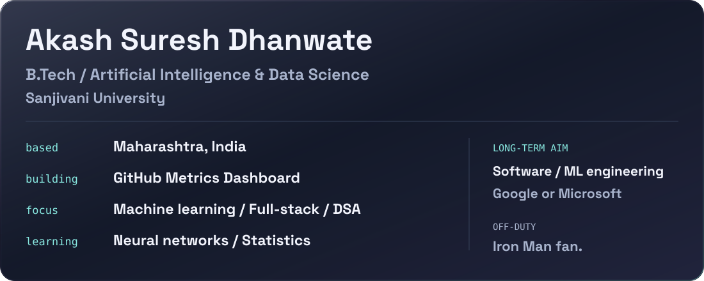
</picture>

- 🎓 **Education:** B.Tech in Artificial Intelligence & Data Science at **Sanjivani University**, Maharashtra, India.
- 🛠️ **Currently Building:** [**GitHub Metrics**](https://github-metrics.learnaids2025.workers.dev/) — full-stack developer analytics & profile comparison engine.
- 🧠 **Focus Areas:** Full-Stack Web Engineering, Data Structures & Algorithms (C++/Java), and Applied Machine Learning.
- 🎯 **Target:** Software Engineering (SWE) or ML Engineering roles at scale.
- 🤝 **Status:** Open to **Software/ML Internships** and select **freelance web builds** — [reach out via email](mailto:akashdhanawate117@gmail.com).

 

## Selected Work

### 01. GitHub Metrics — Developer Analytics & Comparison Platform

  <a href="https://github.com/Akash-Dhanwate/github-metrics">
    <picture>
      <source media="(prefers-reduced-motion: reduce) and (max-width: 600px)" srcset="./assets/projects/metrics-mobile-static.svg">
      <source media="(prefers-reduced-motion: reduce)" srcset="./assets/projects/metrics-static.svg">
      <source media="(max-width: 600px)" srcset="./assets/projects/metrics-mobile.svg">
      
    </picture>
  </a>

`Next.js` · `TypeScript` · `FastAPI` · `Cloudflare Workers`  
**Links:** [Live App ↗](https://github-metrics.learnaids2025.workers.dev/) · [Source Code ↗](https://github.com/Akash-Dhanwate/github-metrics)

---

### 02. House Price Prediction — End-to-End Regression Pipeline

  <a href="https://github.com/Akash-Dhanwate/HousePrice-Prediction-Model">
    <picture>
      <source media="(prefers-reduced-motion: reduce) and (max-width: 600px)" srcset="./assets/projects/house-price-mobile-static.svg">
      <source media="(prefers-reduced-motion: reduce)" srcset="./assets/projects/house-price-static.svg">
      <source media="(max-width: 600px)" srcset="./assets/projects/house-price-mobile.svg">
      
    </picture>
  </a>

`Python` · `Pandas` · `scikit-learn` · `Random Forest`  
**Links:** [Source Code ↗](https://github.com/Akash-Dhanwate/HousePrice-Prediction-Model)

---

### 03. Smart Notes — Fast, Local-First Note Workspace

  <a href="https://github.com/Akash-Dhanwate/Smart-Notes-App">
    <picture>
      <source media="(prefers-reduced-motion: reduce) and (max-width: 600px)" srcset="./assets/projects/smart-notes-mobile-static.svg">
      <source media="(prefers-reduced-motion: reduce)" srcset="./assets/projects/smart-notes-static.svg">
      <source media="(max-width: 600px)" srcset="./assets/projects/smart-notes-mobile.svg">
      
    </picture>
  </a>

`JavaScript` · `CSS3` · `Web Storage API`  
**Links:** [Source Code ↗](https://github.com/Akash-Dhanwate/Smart-Notes-App)

 

## Engineering Toolkit

| Domain | Stack & Tooling |
| :--- | :--- |
| **Languages** | Python, Java, C++, JavaScript, TypeScript |
| **Web & APIs** | React, Next.js, FastAPI, Tailwind CSS, HTML5, CSS3 |
| **Data & ML** | NumPy, Pandas, scikit-learn, PyTorch *(learning)* |
| **Infra & Tools** | Git, GitHub, Linux, Cloudflare, Render |

<b>View Visual Skill Tiles</b>

 

**Languages**

  
  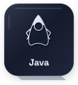
  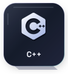
  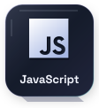
  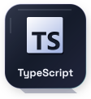

**Web & APIs**

  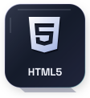
  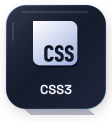
  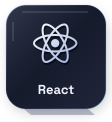
  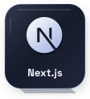
  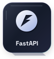
  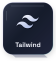

**Data & Machine Learning**

  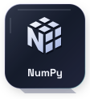
  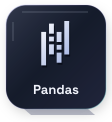
  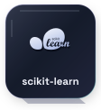
  

**Tools & Deployment**

  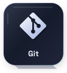
  
  
  
  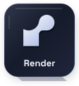

 

## Activity & Contribution Trail

<b>Contribution Snake & Snapshot</b>

 

<picture>
  <source media="(prefers-reduced-motion: reduce) and (prefers-color-scheme: dark)" srcset="./output/github-snake-dark-static.svg">
  <source media="(prefers-reduced-motion: reduce)" srcset="./output/github-snake-static.svg">
  <source media="(prefers-color-scheme: dark)" srcset="./output/github-snake-dark.svg">
  
</picture>

[Live GitHub Activity ↗](https://github.com/Akash-Dhanwate?tab=overview) · [Snapshot Provenance](./output/snapshot.json)

 

<!-- Footer Banner -->
<picture>
  <source media="(max-width: 600px)" srcset="./assets/footer-mobile.svg">
  
</picture>
