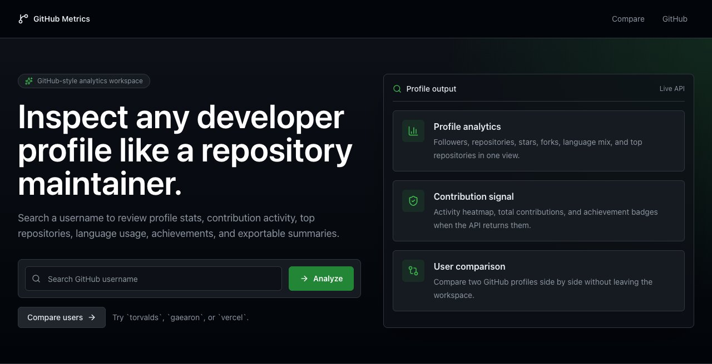

<picture>
  <source media="(prefers-reduced-motion: reduce) and (max-width: 600px)" srcset="./assets/hero-mobile-static.svg">
  <source media="(prefers-reduced-motion: reduce)" srcset="./assets/hero-static.svg">
  <source media="(max-width: 600px)" srcset="./assets/hero-mobile.svg">
  
</picture>

# Akash Dhanwate

**AI & Data Science student. Curious about intelligence. Serious about building.**

<picture>
  <source media="(prefers-reduced-motion: reduce) and (max-width: 600px)" srcset="./assets/focus-mobile-static.svg">
  <source media="(prefers-reduced-motion: reduce)" srcset="./assets/focus-static.svg">
  <source media="(max-width: 600px)" srcset="./assets/focus-mobile.svg">
  
</picture>

  
  
  
  

[Selected work](#selected-work) · [Engineering profile](#engineering-profile) · [Technical inventory](#technical-inventory) · [Activity](#github-activity) · [Contact](#lets-build-something-useful)

## Selected work

### 01 / GitHub Metrics Analytics Dashboard

**Turning GitHub activity into a clearer picture of a developer’s work.**

A full-stack dashboard for exploring profiles, repositories, languages, and contributions. Built with **Next.js, React, TypeScript, and FastAPI**, using GitHub’s REST API for profile analytics and GraphQL for contribution history.

- Compare two developers across repositories, stars, forks, followers, and language usage.
- Explore contribution heatmaps, repository insights, and profile analytics.
- Download profile data as JSON or print a summary; cache repeated API requests.

`Next.js` `TypeScript` `FastAPI` `GitHub REST + GraphQL` `Cloudflare Workers`

[Explore the code ↗](https://github.com/Akash-Dhanwate/github-metrics) · [Open the demo ↗](https://github-metrics.learnaids2025.workers.dev/)

### 02 / House Price Prediction

**A practical experiment in learning from tabular data.**

A Python regression project using the Kaggle House Prices dataset. The repository includes preprocessing, feature engineering, exploratory analysis, a **Random Forest** training pipeline, and a prediction script.

`Python` `Pandas` `NumPy` `scikit-learn` `Jupyter`

[Inspect the model and workflow ↗](https://github.com/Akash-Dhanwate/HousePrice-Prediction-Model)

### 03 / Smart Notes

**Small product. Useful constraints. Framework-free implementation.**

A notes app built with HTML, CSS, and JavaScript: create, edit, and delete notes; pin important entries; search or filter by category; and persist notes and theme preferences in **localStorage**.

`JavaScript` `HTML` `CSS` `Browser storage`

[Explore the implementation ↗](https://github.com/Akash-Dhanwate/Smart-Notes-App)

[Browse all public repositories →](https://github.com/Akash-Dhanwate?tab=repositories)

## Engineering profile

I’m **Akash Suresh Dhanwate**, pursuing a **B.Tech in Artificial Intelligence and Data Science at Sanjivani University**, Maharashtra, India. I learn by building useful projects, understanding the decisions behind them, and improving what I ship.

<!-- Study year intentionally omitted: the published README says "2rd Year"; current year needs confirmation. -->

| Direction | Current focus |
| :--- | :--- |
| **Building** | GitHub Metrics: connecting a Python API, a typed frontend, and useful visualizations. |
| **Learning** | Machine learning, neural networks, probability, statistics, and data analysis. |
| **Practicing** | Data structures and algorithms in C++ and Python; software design fundamentals. |
| **Working toward** | Software engineering and ML opportunities, stronger open-source contributions, and products that solve real problems. |

Long term, I want to become an exceptional engineer and contribute at a leading technology company such as Google or Microsoft. Along the way, I’m interested in freelance web development and practical digital solutions for businesses.

## Technical inventory

Tools I use across projects and learning. Inclusion reflects exposure and practice, not an expertise rating.

| Area | Technologies |
| :--- | :--- |
| **Languages** | `Python` · `Java` · `C++` · `JavaScript` · `TypeScript` |
| **Web & APIs** | `HTML5` · `CSS3` · `React` · `Next.js` · `Tailwind CSS` · `FastAPI` |
| **Data & ML** | `NumPy` · `Pandas` · `scikit-learn` · `PyTorch` (learning) |
| **Tools & deployment** | `Git` · `GitHub` · `Linux` · `Cloudflare` · `Render` |

## GitHub activity

An animated trail through my public contribution grid. A stored snapshot of the work along the way.

<picture>
  <source media="(prefers-reduced-motion: reduce) and (prefers-color-scheme: dark)" srcset="./output/github-snake-dark-static.svg">
  <source media="(prefers-reduced-motion: reduce)" srcset="./output/github-snake-static.svg">
  <source media="(prefers-color-scheme: dark)" srcset="./output/github-snake-dark.svg">
  
</picture>

[See the current contribution history on GitHub →](https://github.com/Akash-Dhanwate?tab=overview) · [Snapshot provenance](./output/snapshot.json)

## Let’s build something useful

Have an internship opportunity, an interesting engineering problem, or a business that needs a better web presence? I’d like to hear about it.

**[akashdhanawate117@gmail.com](mailto:akashdhanawate117@gmail.com)** · [LinkedIn](https://www.linkedin.com/in/4kashdhanwate) · [X](https://x.com/akash_dhanwate7)

<picture>
  <source media="(max-width: 600px)" srcset="./assets/footer-mobile.svg">
  <source media="(prefers-reduced-motion: reduce)" srcset="./assets/footer-static.svg">
  
</picture>
