<picture>
  <source media="(prefers-reduced-motion: reduce) and (max-width: 600px)" srcset="./assets/hero-mobile-static.svg">
  <source media="(prefers-reduced-motion: reduce)" srcset="./assets/hero-static.svg">
  <source media="(max-width: 600px)" srcset="./assets/hero-mobile.svg">
  
</picture>

**B.Tech AI & Data Science** · Sanjivani University, India.

  
  
  
  

## Selected work

<a href="https://github.com/Akash-Dhanwate/github-metrics">
  <picture>
    <source media="(prefers-reduced-motion: reduce) and (max-width: 600px)" srcset="./assets/projects/metrics-mobile-static.svg">
    <source media="(prefers-reduced-motion: reduce)" srcset="./assets/projects/metrics-static.svg">
    <source media="(max-width: 600px)" srcset="./assets/projects/metrics-mobile.svg">
    
  </picture>
</a>

[Live demo ↗](https://github-metrics.learnaids2025.workers.dev/)

<a href="https://github.com/Akash-Dhanwate/HousePrice-Prediction-Model">
  <picture>
    <source media="(prefers-reduced-motion: reduce) and (max-width: 600px)" srcset="./assets/projects/house-price-mobile-static.svg">
    <source media="(prefers-reduced-motion: reduce)" srcset="./assets/projects/house-price-static.svg">
    <source media="(max-width: 600px)" srcset="./assets/projects/house-price-mobile.svg">
    
  </picture>
</a>

<a href="https://github.com/Akash-Dhanwate/Smart-Notes-App">
  <picture>
    <source media="(prefers-reduced-motion: reduce) and (max-width: 600px)" srcset="./assets/projects/smart-notes-mobile-static.svg">
    <source media="(prefers-reduced-motion: reduce)" srcset="./assets/projects/smart-notes-static.svg">
    <source media="(max-width: 600px)" srcset="./assets/projects/smart-notes-mobile.svg">
    
  </picture>
</a>

## Toolkit

  
  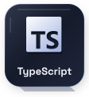
  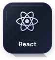
  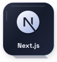
  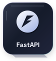
  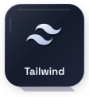

  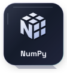
  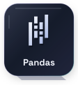
  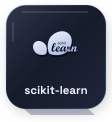
  
  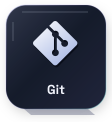
  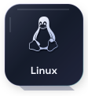

Tools from projects and learning. PyTorch: learning.

Learning ML. Building useful software. Open to internships and web projects.

Contribution trail

<picture>
  <source media="(prefers-reduced-motion: reduce) and (prefers-color-scheme: dark)" srcset="./output/github-snake-dark-static.svg">
  <source media="(prefers-reduced-motion: reduce)" srcset="./output/github-snake-static.svg">
  <source media="(prefers-color-scheme: dark)" srcset="./output/github-snake-dark.svg">
  
</picture>

[Current history](https://github.com/Akash-Dhanwate?tab=overview) · [Snapshot provenance](./output/snapshot.json)

<picture>
  <source media="(max-width: 600px)" srcset="./assets/footer-mobile.svg">
  
</picture>
